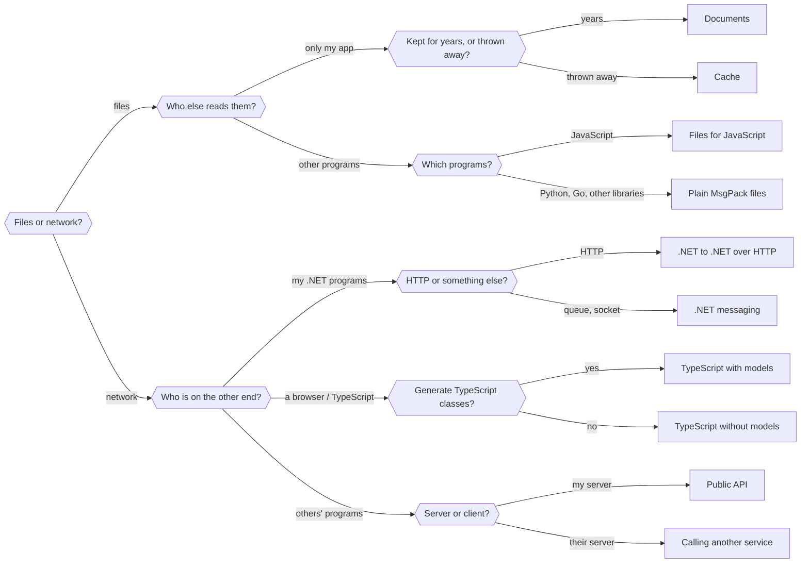

# Setup wizard: which packages and settings do I need?

This wizard asks you a few questions about what you're building. Each answer takes you to the next page, and the last page gives you a complete setup: the packages to install, the settings to use, code to copy, and what to watch out for later.

You don't need to know MsgPack to follow it. Every question explains its terms, with an example.

> **MsgPack in one paragraph.** A *serializer* turns your objects (an `Invoice` with its lines) into bytes, so you can store them or send them somewhere, and turns those bytes back into objects later. JSON is the best-known format for this, and it's text. MsgPack is the same idea in a compact binary form: smaller and faster to read and write, but not readable by eye. These packages serialize your .NET classes to MsgPack the way System.Text.Json does to JSON, with extras such as a schema that writes property names only once.

The whole tree at a glance (click a page in the list below it):

- Questions: [Files](Files.md), [Files of your own app](FilesOwnApp.md), [Files for other programs](FilesOtherPrograms.md), [Network](Network.md), [Between .NET programs](NetworkDotNet.md), [Browser and TypeScript](NetworkBrowser.md), [Other parties](NetworkOthers.md)
- Setups: [Documents](Setup-Documents.md), [Cache](Setup-Cache.md), [Files for JavaScript](Setup-FilesJavaScript.md), [Plain MsgPack files](Setup-FilesPlain.md), [.NET to .NET over HTTP](Setup-DotNetHttp.md), [.NET messaging](Setup-DotNetMessaging.md), [TypeScript with models](Setup-TypeScriptModels.md), [TypeScript without models](Setup-TypeScriptPlain.md), [Public API](Setup-PublicApi.md), [Calling another service](Setup-ForeignService.md)
- For every setup: [Add-ons](Extras.md) (trimming and AOT, analyzers, finding mismatches, untrusted data, looking inside the bytes)

---

> **Shortcut:** if speed and efficiency are all you care about, and you don't need data to stay readable across versions (no old files to open after an update, no old and new versions talking to each other during a rolling upgrade), go straight to **[Caches and temporary files](Setup-Cache.md)**.

## Question 1: will the data be saved, or sent?

Think about what happens to the bytes right after you serialize them.

### Saved: files and other storage

The bytes are **written now and read later**, possibly much later, possibly by a newer version of your program. The reader isn't running yet when the writer writes.

Examples:
- A drawing app saves `.drawing` documents that users open again next year.
- A game writes its save games.
- A service keeps computed results in a cache (Redis, a temp folder) for ten minutes.
- An export file that a Python script picks up at night.

**→ [The data is saved](Files.md)**

### Sent: messages over the network

The bytes **travel from one running program to another**, usually within seconds: a request and its response, a message on a queue, a frame on a WebSocket. Both sides are running, and often both are yours.

Examples:
- An ASP.NET Core API answers a WPF, MAUI or Blazor app.
- A React or Angular front end calls its own ASP.NET backend.
- Microservices put orders on a RabbitMQ or Azure Service Bus queue.
- Your app calls someone else's API that speaks MsgPack.

**→ [The data is sent](Network.md)**

### Not sure?

Message queues are in between: a message may wait in the queue for a while, but it is still a message between running programs, so choose *sent*. A database column holding serialized objects is *saved*.

Doing both? Most apps do (save documents *and* call an API). Walk through the wizard once for each: the setups can be combined, they use the same packages.
